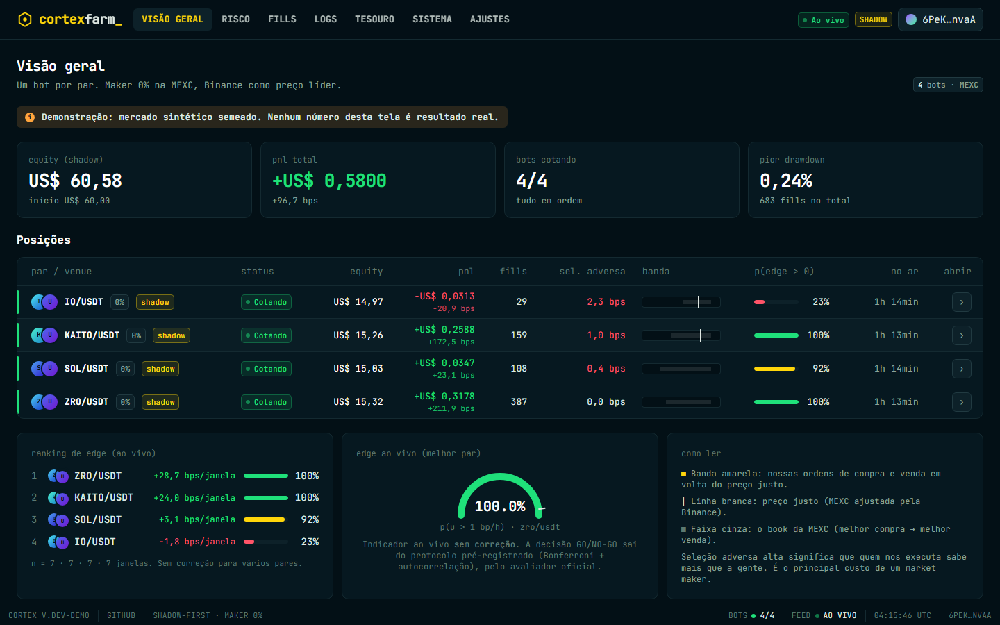
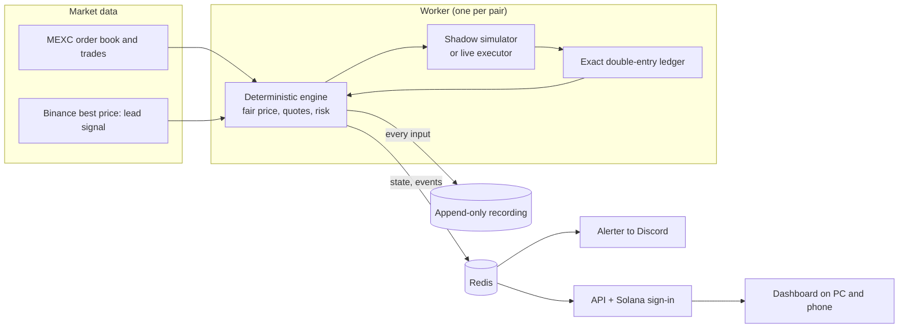
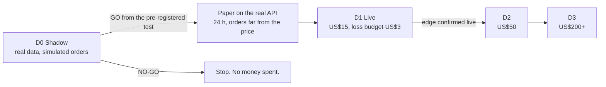
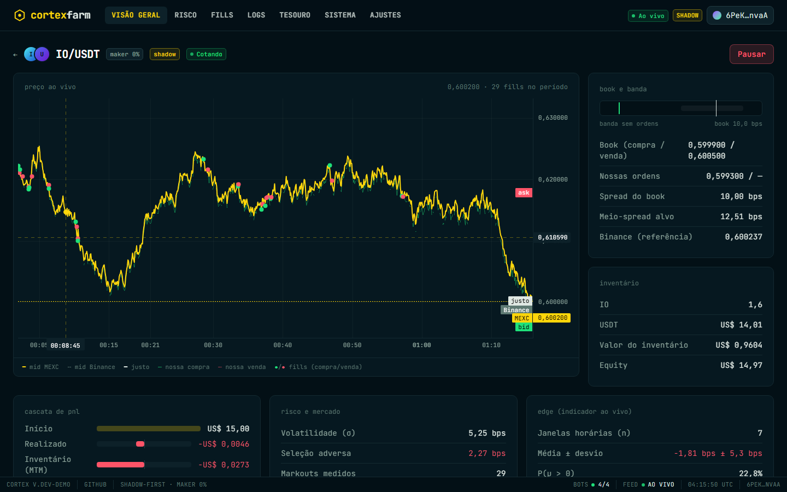
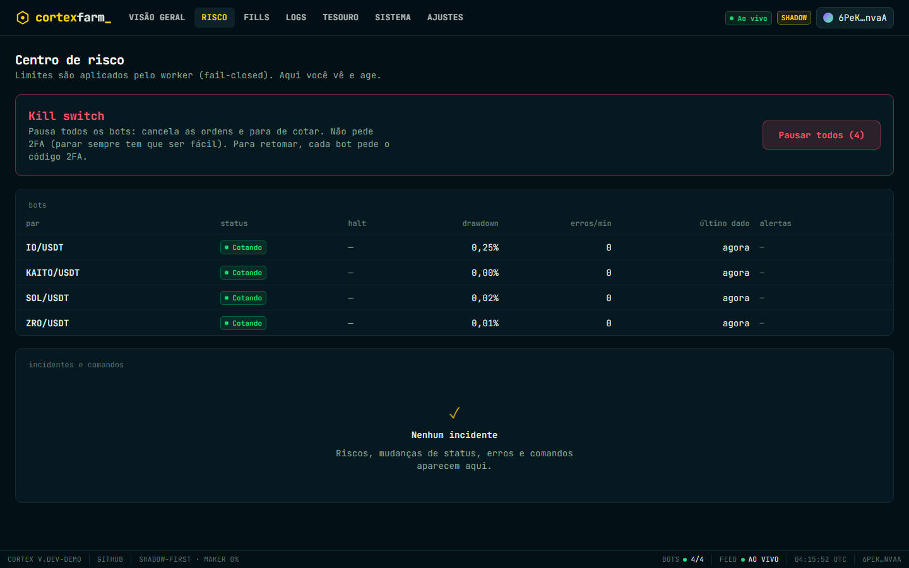
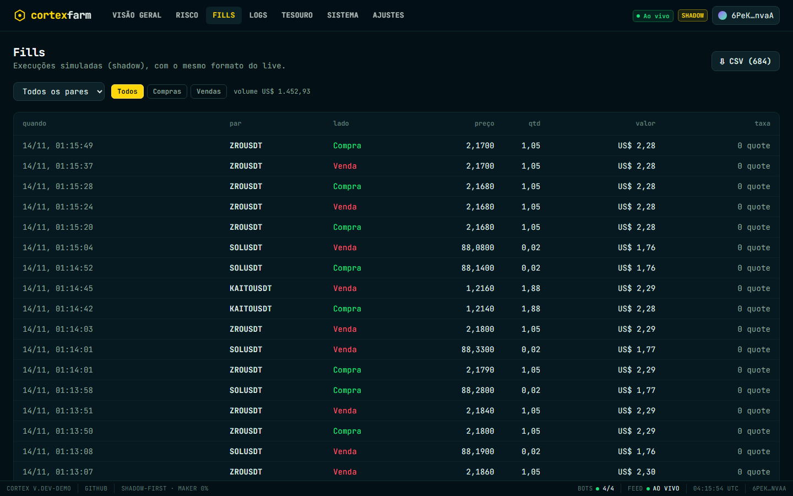
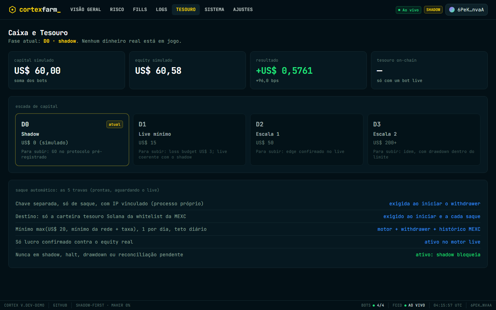
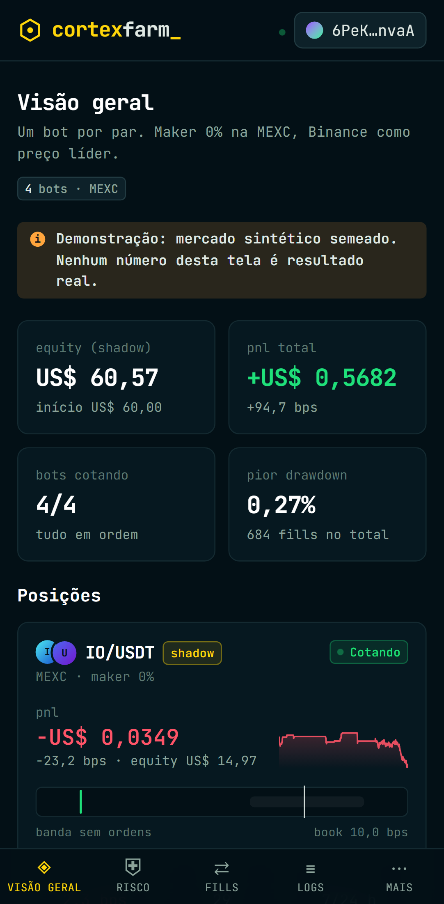
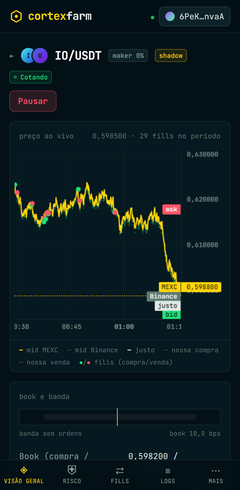

# Cortex Farm

Cortex Farm is an automated market-making bot for the MEXC spot exchange. It is built to run unattended on a small server, starting with US$15. Two rules come before profit:

- **It measures before it risks money.** It first trades in *shadow* mode: real market data, simulated orders, no money. Real money is used only if a statistical test, written down before the data is seen, says the strategy has an edge.
- **Losses have a ceiling.** The worst case in live trading is about US$4.50 (loss budget plus inventory cap). The only risk outside that ceiling is the exchange itself failing.

**No profit is promised.** Most market-making attempts by small traders lose money. This project is built to give a true answer about whether this one works, and to lose very little while it finds out.



<p align="center">
  
  <br>
  <sub>A short tour of the dashboard (<a href="docs/media/tour.mp4">full-quality video</a>). All media show a seeded synthetic demo, not a trading result.</sub>
</p>

---

## Contents

1. [The idea in plain words](#1-the-idea-in-plain-words)
2. [How it works](#2-how-it-works)
3. [From simulation to real money](#3-from-simulation-to-real-money)
4. [Safety rules](#4-safety-rules)
5. [The dashboard](#5-the-dashboard)
6. [Try it on your computer](#6-try-it-on-your-computer)
7. [Running it for real](#7-running-it-for-real)
8. [Repository map](#8-repository-map)
9. [Tests and evidence](#9-tests-and-evidence)
10. [Status](#10-status)

---

## 1. The idea in plain words

A **market maker** works like a currency exchange booth. It always offers to buy a little below the market price and to sell a little above it. When one person sells to it and another buys from it, the booth keeps the small difference, called the *spread*.

Three facts make this possible with a tiny account:

| Fact | Why it matters |
|---|---|
| MEXC charges a **0% fee** on orders that wait in the order book (maker orders). | Fees do not eat the small spread. |
| Binance usually moves **first**, and MEXC follows a moment later. | The bot watches Binance to see where the price is going. It moves its orders out of the way before slow quotes get picked off. |
| The bot holds only a **small inventory**, at most about 20% of the account. | A sudden crash can only hurt a small part of the money. |

The main danger is **adverse selection**. The people who trade against you often know something you do not. After every fill, the bot measures how far the price moved against it. It adds that cost to its quotes. The shadow test then decides whether the spread pays for it.

---

## 2. How it works



**One second in the life of a bot:**

1. A new price arrives from MEXC or Binance.
2. The engine computes a *fair price* (MEXC adjusted by Binance) and how volatile the market is.
3. It decides where to place its buy and sell orders with the Avellaneda-Stoikov model. Orders sit wider apart when the market is jumpy or when informed traders are hitting it. They shift down when the bot already holds too much of the coin.
4. It turns that into valid orders. Each order is rounded to the exchange's price and size steps and is always *post-only*, so it never pays the taker fee. It is never bigger than the cash or coins the bot actually has.
5. Every fill is booked in an exact double-entry ledger and checked against the strategy's own balances. Any mismatch stops the bot (*fail-closed*).

**Determinism.** The engine has no clock, no randomness and no network access of its own. It is a pure function of its inputs, and every input is recorded. A whole day can be replayed with a bit-identical result. Crash recovery, audits and the official GO/NO-GO evaluation all depend on this.

| Part | What it does |
|---|---|
| `packages/core` | The pure engine: quoting math, the strategy state machine, simulator, ledger, risk rules and statistics |
| `apps/worker` | Connects the engine to the exchanges. Contains the shadow worker, live worker, recorder, snapshots, alerter and withdrawer |
| `apps/api` | HTTP and WebSocket API. You sign in with a Solana wallet (Phantom); resuming trading needs a 2FA code |
| `apps/web` | The dashboard (React). Works on a phone; the API serves it from the same origin |
| `infra` | Docker images, the production compose file, VPS setup, backups, and deploys with automatic rollback |

---

## 3. From simulation to real money



**The GO/NO-GO test is fixed before the data exists.** The pairs, the decision rule and a fingerprint of the exact code are sealed in `infra/prod/protocol.json` before the shadow window opens.

The test looks at results only on days 7, 14 and 21. It corrects for two things that make results look better than they are:

- testing several pairs at once;
- consecutive hours not being independent of each other.

In simulations, the chance of a false GO stays under 5% with these corrections. Without them it reaches 28%.

**Half of the profit is protected.** Profit counts only when it is realized *and* confirmed by the account's real value. Half of it goes to a *treasury* that is never traded. Once the treasury reaches US$20, it can be withdrawn to one Solana wallet. A separate process does the withdrawals, with its own withdraw-only key and five independent locks ([design](docs/E9-DESIGN.md)).

---

## 4. Safety rules

These rules are enforced by code and covered by tests:

- **Shadow is the default.** Live trading needs all of the following:
  - an explicit setting;
  - a separate program;
  - an acknowledgement from the operator;
  - a passed GO test.
- **The trading key cannot withdraw.** Withdrawals use a different key. That key lives in a different process, which never sees the trading key, and can send only to an address already whitelisted on the exchange.
- **Fail-closed.** An unknown error cancels all orders and pauses the bot. If the exchange gives an unclear answer, the bot does not guess. If the ledger does not match the exchange, the bot stops.
- **Hard limits:**
  - a loss budget of US$3, enforced by a kill switch;
  - a maximum drawdown and a daily loss limit;
  - an inventory cap;
  - automatic pauses when data is stale or the clock drifts.
- **No secrets in git.** Only `.env.example` is committed. The repository is public.

---

## 5. The dashboard

The dashboard is a Revert-style analytics terminal. It shows one row per bot, live charts, the risk center, the full fill history, the logs and the treasury.

- You sign in by signing a message with a Solana wallet. This is not a transaction and costs nothing.
- Pausing a bot takes one click. Resuming or resetting needs a 2FA code.
- Every action is written to an audit log.

| Bot detail | Risk center |
|---|---|
|  |  |
| **Fills** | **Cash and treasury** |
|  |  |

<p align="center">
  
  &nbsp;&nbsp;
  
</p>

How to read a bot:

- **Band** (yellow): our buy and sell orders around the fair price (white line). The grey area is the exchange's best buy and sell price.
- **Adverse selection**: how far the price moved against us after our fills, on average. Lower is better. It is the main cost of market making.
- **P(edge > 0)**: a live indicator without statistical corrections. Only the pre-registered test makes the real decision.

---

## 6. Try it on your computer

You need Node.js 22.12 or newer.

```bash
npm ci
npm run demo
```

This builds the dashboard and starts a local demo with four pairs trading on seeded synthetic markets. It uses the real engine and the real API, with in-memory storage. You do not need an exchange account, Docker or a database.

To sign in with your own Phantom wallet, add its address:

```bash
npm run demo -- --allow <your Solana address>
```

Then open `http://127.0.0.1:8080`. Use `127.0.0.1` rather than `localhost`, because the API checks the page's origin. The terminal also prints a 2FA secret for the demo, which you need to resume a paused bot.

Other useful commands:

| Command | What it does |
|---|---|
| `npm test` | Runs all unit, property and integration tests |
| `npm run typecheck` | Checks types with strict TypeScript |
| `npm run e2e` | Builds the dashboard and tests it in a real browser, on desktop and phone sizes |
| `npx tsx apps/worker/src/replay.ts <run dir>` | Replays a recording and prints its result hash |
| `npm run media` | Regenerates the screenshots and video in `docs/media` (the demo must be running on port 8091, see the script header) |

---

## 7. Running it for real

Production runs on one small VPS in Tokyo, close to the exchanges. It is reachable only through Tailscale, with no public port. The server runs:

- one container per pair;
- Postgres with TimescaleDB, and Redis;
- a dead-man check (healthchecks.io) and Discord alerts;
- encrypted off-site backups.

If a new version is unhealthy after a deploy, it rolls back automatically.

The step-by-step guide is in [`docs/runbooks/vps.md`](docs/runbooks/vps.md). Every setting is listed in [`.env.example`](.env.example).

---

## 8. Repository map

```
packages/
  core/        pure engine: quoting/, strategy/, sim/, accounting/, risk/, stats/, treasury/, scanner/
  exchange/    MEXC REST (signed) and protobuf WebSocket, Binance reference stream
  shared/      types shared by the API, the worker and the dashboard
  db/          Prisma schema and migrations (Postgres + TimescaleDB)
apps/
  worker/      shadow worker, live worker, recorder, replay, evaluator, alerter, withdrawer
  api/         Fastify API, Solana sign-in, 2FA, audit log, local demo server
  web/         dashboard (React + Vite + Tailwind)
infra/         Docker images, production compose file, VPS scripts
docs/          design notes, runbook, progress log, media
```

---

## 9. Tests and evidence

- **Over 300 automated tests.** They include unit tests, property tests (thousands of random cases), integration tests against fake exchanges, and dashboard tests in a real browser.
- **Replay is bit-exact.** One real hour of MEXC SOL/USDT data (144,178 records) gives the same hash live and in replay.
- **Crash recovery is bit-exact.** A live session was killed mid-run (`kill -9`) and restarted. After the restart, its state matched an uninterrupted run bit for bit.
- **The bot keeps quoting unattended (AFK liveness).** A test checks that the bot keeps placing orders for hours, across many simulated markets. This test caught real bugs. In one, a tiny leftover position, too small to sell and too large to add to, used to freeze the bot forever.
- **CI runs on every push:**
  - type checks;
  - the test suite;
  - a database migration on a real TimescaleDB;
  - browser tests;
  - Docker image builds for two CPU architectures.

Detailed evidence for each phase is in [`docs/PROGRESS.md`](docs/PROGRESS.md). The master plan is in [`docs/MASTER-PLAN.md`](docs/MASTER-PLAN.md).

---

## 10. Status

| Phase | State |
|---|---|
| Engine, simulator, ledger, risk, replay, crash recovery | Done and proven |
| Dashboard, API, alerts, pair scanner, GO/NO-GO protocol | Done |
| Live trading, treasury and auto-withdraw | Built and tested, locked until a GO |
| 24/7 shadow on the VPS and the 21-day measurement | Waiting for the server |

---

## License and disclaimer

ISC license. This is experimental software for research. Trading crypto assets can lose all the money involved. Nothing here is financial advice.
